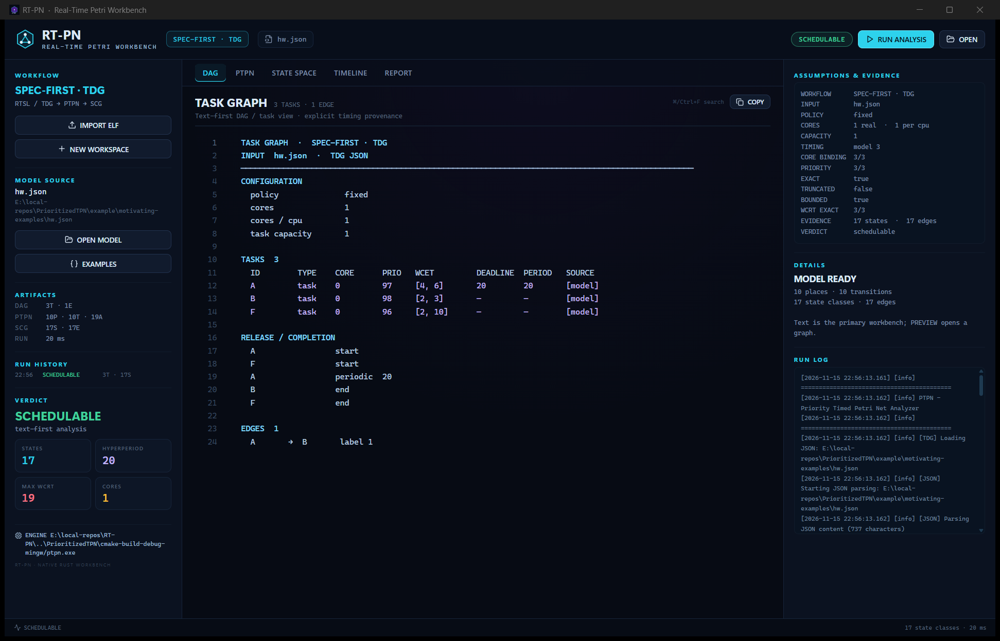

# RT-PN

Native desktop workbench for the **Priority Timed Petri Net (PTPN)** analyzer.

RT-PN is the Rust desktop front-end of
[PrioritizedTPN](https://github.com/kevindadi/PrioritizedTPN). The analyzer,
lowering and scheduling analysis stay in the original C++17 CLI; RT-PN owns the
desktop workflow, text-first presentation and explicit graph previews.

Built with **Tauri 2 + React + TypeScript**:

- native window and file dialogs, Rust command boundary
- CodeMirror 6 for dense text stages, line numbers, search and selection
- React Flow for on-demand PTPN / state-class / CFG / thread previews
- no graph is shown by default; text remains the primary representation

## Workflows

### Specification-first

`RTSL` / TDG JSON / PTPN → analyzer → `DAG`, `PTPN`, `STATE SPACE`, `TIMELINE`,
`REPORT` text stages. Assumptions, core/priority coverage, exactness and
truncation stay visible in the inspector; `PREVIEW` opens a PTPN or state-class
graph.

### Binary-first

`ELF` → readable ELF layout → readable CFG + preview image.

Importing an `.elf`, `.out` or `.axf` binary now runs the bundled `elf2tdg`
extractor instead of loading a pre-made parser bundle:

1. `elf2tdg <elf> --view elf` writes a readable ELF loader view
   (`<stem>.elf.mmd`, Mermaid layout source) shown in the `ELF` stage.
2. `elf2tdg <elf> --view cfg --format json` writes a readable CFG document
   (`<stem>.cfg.json`); the `CFG` stage renders a compact listing of functions,
   blocks and calls, and `PREVIEW` shows the Graphviz SVG rendering of
   `<stem>.cfg.dot` (falling back to an interactive function-level graph when
   Graphviz is not installed).
3. Raw `elf2tdg` outputs are kept next to the analysis artifacts
   (`%LOCALAPPDATA%\RT-PN\artifacts\elf-*` on Windows; override with
   `PTPN_ARTIFACT_DIR`).

Threads/net stages and the PTPN analysis backend are intentionally pending:
these views are parser artifacts and previews, not a certified schedulability
verdict. The Rust Petri-net simulator backend is developed separately.

## Development

Prerequisites:

- Rust (MSVC toolchain on Windows)
- Node.js 20+ and npm
- WebView2 (included with Windows 11)
- CMake 3.27+, Ninja, a vcpkg checkout, and the Visual Studio C++ build tools
  (the release `ptpn` is a static MSVC build)
- `just` (`winget install --id Casey.Just`)

The two analysis engines are git submodules under `engines/`; the top-level
`just` recipes build them and stage them as Tauri sidecars:

```bash
git submodule update --init
npm install
just doctor        # report the detected CMake/Ninja/C++/vcpkg/rustc
just dev           # build + stage the engines, then start the desktop app
```

Machine-local tool paths can live in `.env.local` (start from
`.env.local.example`). Detection prefers the environment overrides, then `PATH`,
then the Visual Studio toolchain (CMake, `cl.exe` via `vcvars64.bat`) and the
CMake/Ninja bundled with CLion, then `D:/vcpkg` for vcpkg.

The desktop window is created in Rust, so WebView2 state is kept in
`.webview2/` during development and under the portable package's `webview2/`
directory when `RT_PN_WEBVIEW_DATA_DIR` is set.

The plain `npm run tauri dev` still works once the sidecars are staged with
`just stage`.

Engine discovery depends on the build mode. `just stage` builds both engines and
stages them as Tauri sidecars, so neither mode needs extra configuration by
default:

- **Debug builds** (`just dev`): `PTPN_BIN` / `ELF2TDG_BIN` override → sidecar
  next to the app executable → repository build trees (`cmake-build-*/`,
  `build/ptpn`, `build/cargo/release`) → `PATH`. This keeps isolated engine
  development possible; the sidebar shows which source was used.
- **Release builds** (installers / portable package): `PTPN_BIN` /
  `ELF2TDG_BIN` override is honored but flagged as `ENV·EXTERNAL` in the
  sidebar → `ptpn.exe` / `elf2tdg.exe` (or `bin/…`) next to the app executable
  → error. The working directory and `PATH` are never scanned, so a stray CLI
  cannot shadow the bundled sidecars.

The desktop app never reimplements analysis. It launches the CLI with
`tdg|rtsl|ptpn -f … --export-ptpn --export-scg --export-metrics --export-wcet`
and parses the exports.

### Resource budgets and long runs

Petri-net state-class reachability is exponential in the model, so every
analysis is bounded. The inspector's `RESOURCE BUDGET` block passes
`--max-states` (default 20000), `--timeout` (default 120 s) and `--max-memory`
(default 2048 MB) to `ptpn`; setting timeout or memory to `0` disables that
bound. When a limit fires the engine exits `5` and the workbench marks the run
`PARTIAL` — the state class graph is then an incomplete prefix and the metrics
are conservative bounds. Runs can be cancelled while the engine explores
(the process is terminated), analyzer output streams into the run log, and
`RUN HISTORY` keeps structured snapshots so the latest two runs can be compared
(WCRT, state counts, exactness and truncation regressions). `EXPORT MD` /
`EXPORT JSON` write a report containing the budgets, partial flag, metrics and
stage text.

### Deadlock counterexamples and pending timings

When the explored state space contains reachable deadlocks, the inspector's
`COUNTEREXAMPLE` section shows the shortest transition path from the initial
state class to a deadlock (markings included) and opens it as a graph preview;
the same trace is included in exported reports.

RTSL models with `measured by llm` timing are not analyzable until the pending
intervals are filled. `PENDING TIMING` runs `ptpn check --diagnostics json`,
lists the pending tasks with their expected interval count, and `FILL &
ANALYZE` feeds the entered `[min, max]` pairs to `ptpn fill`. The patched source
is written to the artifact directory and analyzed immediately, leaving the
original model untouched.

### Charts, core allocation and project files

- `WCRT / SLACK` draws a compact per-task bar chart (deadline marker, red on a
  deadline miss) from the metrics JSON.
- `CORE ALLOCATION` runs `ptpn allocate` with bounded candidates and shows the
  search summary, the best assignment and the Pareto front with WCRT, core
  load, deadlock count and state count per candidate.
- `SAVE PROJECT` / `OPEN PROJECT` store `{version, workflow, modelPath, stage,
  budgets, savedAt}` in a `.rtpn` file; opening a project restores the budget,
  re-runs the model and returns to the saved stage.

Exports default to `%LOCALAPPDATA%\RT-PN\artifacts` on Windows. If that
directory is not writable (for example under a restricted runner), RT-PN probes
and falls back to `.rt-pn-artifacts` in the current workspace. Override with:

```text
PTPN_ARTIFACT_DIR
PTPN_MINGW_BIN        # MinGW runtime `bin` directory, if needed
```

A model can also be opened by launching the app with a path argument:

```bash
rt-pn.exe example/motivating-examples/hw.json
rt-pn.exe firmware.elf
```

## Build

```bash
just build     # stage the engines, then `tauri build`
just dist      # installers + portable zip + versions.json
```

Artifacts:

- `src-tauri/target/release/bundle/` — NSIS installer and MSI
- `dist/rt-pn-portable/` and `dist/RT-PN-<version>-portable-<arch>.zip` —
  portable package with both engine CLIs in `bin/`
- `dist/rt-pn-portable/versions.json` — exact engine commits and tool versions

Plain `npm run tauri build` works too, but requires the sidecars to be staged
first (`just stage`): Tauri validates `bundle.externalBin` at build time.

The application icon is generated from `scripts/make-icon.ps1`
(`npm run tauri -- icon src-tauri/icons/source.png`); the generated
`src-tauri/icons/` set is committed because the Windows bundlers need it.

Other recipes: `just test` (engine tests + desktop backend tests + typecheck +
e2e), `just engines` (engine builds only), `just update-engines` (bump the
submodule pins), and `just clean`.

## Keyboard

- `Ctrl+F` / `Cmd+F` — search within the active text stage
- `Esc` — close a graph preview
- drag an `.rtsl`, `.json`, `.ptpn`, `.elf`, `.out` or `.axf` file onto the window

## Layout

```text
engines/prioritized-tpn/  C++ analyzer submodule (PTPN / WCRT / deadlock CLI)
engines/elf2tdg/          Rust ELF -> Task Dependency Graph submodule
docs/ptpn/                Analyzer documentation moved from the CLI repository
scripts/                  build / stage / package / version scripts
Justfile                  unified build entry
build/                    generated engine build outputs (ignored)
src-tauri/binaries/       generated Tauri sidecars (ignored)
src/                 React workbench
  App.tsx            workflow, stages, inspector, run history
  CodeStage.tsx      CodeMirror text surface
  GraphPreview.tsx   React Flow preview
  api.ts             Tauri commands and native dialogs
src-tauri/src/       Rust backend
  lib.rs             Tauri commands
  cli.rs             ptpn discovery + export orchestration
  model.rs           analysis result model
  dot.rs             PTPN / state-class DOT parser
  workbench.rs       text stage renderers
  binary.rs          ELF parser bundle loader
  graph.rs           serializable preview graph
```



## Status

- Specification-first: functional.
- Binary-first: `elf2tdg` drives the ELF loader view, readable CFG and Graphviz
  preview image; threads/net and the analysis backend are pending.
- Unified build: `just` + engine submodules; both CLIs ship as Tauri sidecars.
- Qt desktop: replaced by RT-PN; the C++ CLI remains unchanged.

## License

MIT — see [LICENSE](LICENSE). The bundled analyzer engine
([PrioritizedTPN](https://github.com/kevindadi/PrioritizedTPN)) is MIT and the
ELF extractor ([elf2tdg](https://github.com/kevindadi/elf2tdg)) is
MIT OR Apache-2.0.


